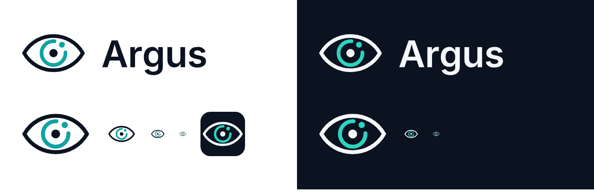

# Argus brand

## The mark

An eye whose iris is an **open measurement ring**, with a **tracking point** orbiting in the gap. It stands for Argus Panoptes, the hundred-eyed watchman who never slept, and for what the product does: watch, track, measure. Simple enough to read at small sizes.

| File | Use |
| --- | --- |
| `argus-logo.svg` / `argus-logo-dark.svg` | Horizontal logo (mark + wordmark) on light / dark backgrounds |
| `argus-logo-1074.png` / `argus-logo-dark-1074.png` | Same, as PNG (README, slides, social) |
| `argus-mark.svg` / `argus-mark-dark.svg` | Mark only, light / dark |
| `argus-mark-mono.svg` | One color, uses `currentColor` (inherits text color in the UI) |
| `argus-app-icon.svg`, `-512.png`, `-192.png` | App icon / PWA icons |
| `favicon.svg`, `favicon-32.png` | Browser tab. Uses the filled app icon because the plain eye gets too thin at 16 px |

The wordmark is **Inter SemiBold**, converted to outlines (SIL Open Font License), so the files render the same everywhere without the font installed.

## Colors

| Token | Light | Dark | Use |
| --- | --- | --- | --- |
| Ink | `#0B1220` | `#F5F7FA` | Text, eye outline, pupil |
| Accent (Argus teal) | `#0FA3A3` | `#2DD4BF` | Iris ring, tracking point, the one accent color in the UI |

Use the accent sparingly: live/active states, the current selection, key data. Keep status colors (success, warning, critical) separate from the accent.

## Motion idea for the mark

The tracking point can orbit the iris ring as Argus's **loading / "watching" indicator**, and the ring can close fully when a measurement locks in. Keep it subtle and respect `prefers-reduced-motion`.

## Rules

- Keep clear space around the logo of at least the height of the pupil ring.
- Don't stretch, recolor outside these tokens, add effects or rotate the mark.
- Minimum size: mark 20 px, horizontal logo 96 px wide.
